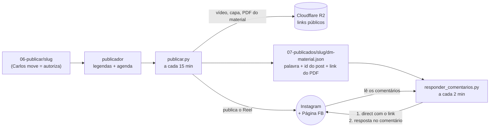

# Automação Instagram — postar e entregar material

> Versão simples, decidida pelo Carlos em 2026-10-09: **sem CRM, sem conversa, sem servidor**.
> Comentou a palavra-chave → resposta no comentário → material no direct, com convite para curtir e seguir.
> Textos editáveis: `respostas.yaml` (nesta pasta). Formato do `post.json`: `docs/contratos.md` §10.

---

## 1. Como funciona

Tudo roda **no Mac**, dentro deste projeto, com dois agendadores do macOS (launchd):



| Peça | O que faz | Estado |
|---|---|---|
| `scripts/publicar.py` | publica o Reel no IG e no FB na hora agendada e grava `dm-material.json` | pronto, 62/62 no teste offline, **nunca publicou de verdade** |
| `scripts/responder_comentarios.py` | lê os comentários dos Reels dos últimos 7 dias, acha a palavra, manda o direct e responde no comentário | pronto, 25/25 no teste offline (`tests/comentarios/`), **nunca rodou de verdade** |
| `automacao-meta/respostas.yaml` | as frases (5 respostas públicas sorteadas + a mensagem do direct), limites, liga/desliga | pronto |
| `scripts/launchd/instalar.sh` | instala os dois agendadores | pronto, **não instalado** |

**Por que sem servidor:** em vez de a Meta avisar (webhook, que exige um endereço na internet ligado 24 h), o script **pergunta** ao Instagram a cada 2 minutos se há comentários novos. Com o Mac desligado, nada se perde: a Meta deixa responder até 7 dias depois do comentário, e o script responde quando o Mac voltar. Se um dia o atraso incomodar, o mesmo script pode ir para um servidor sem mudar nada.

---

## 2. O que acontece num comentário

1. Alguém comenta "prompt 🙏" num Reel cuja palavra é `PROMPT`. Maiúscula, acento e pontuação não importam; o plural (`PROMPTS`) conta (`aceitar_plural` no yaml). Palavra dentro de outra (`superprompt`) não conta.
2. O script manda **um direct** (resposta privada ao comentário):
   > Oi, @ana! 👋 Aqui é o envio automático da Korvu.
   > Aqui está o guia do prompt que você pediu no vídeo: https://…/guia.pdf
   > Se o conteúdo te ajudou, deixa seu like no Reel e segue a @korvu_oficial — toda semana tem IA nova explicada do jeito simples 🚀
3. **Só se o direct saiu**, ele responde em público no comentário, com uma frase sorteada ("Recebido, @ana! Já te mandei no direct 📩"). Assim nunca diz "te mandei" sem ter mandado.
4. Fica anotado em `_controle/comentarios/estado.json`, e ninguém recebe duas vezes no mesmo Reel.

Ignora: comentários da própria @korvu_oficial, comentários sem a palavra, Reels com mais de 7 dias, Reels sem material.

**Erros:**
- Falha passageira da Meta → tenta de novo na passagem seguinte (até 5 vezes).
- A pessoa não pode receber (bloqueou, direct fechado, passou a janela) → desiste só daquela pessoa.
- Token vencido ou falta de permissão → **para tudo sem descartar ninguém** e avisa o Carlos (notificação do Mac, no máximo 1 por hora). Quando resolver, os pendentes saem.

---

## 3. Limites da Meta

- **Um** direct por comentário, até **7 dias** depois do comentário. Mandar outra mensagem só é possível se a pessoa responder. Por isso o material vai como **link** já na primeira mensagem.
- Quem não segue a conta recebe o direct em **"Solicitações de mensagem"**. É normal.
- A Meta limita mensagens automáticas por hora. O script fica abaixo do limite: no máximo 25 por passagem e 150 por hora, com 4 s entre envios (`respostas.yaml`).

---

## 4. Ferramentas — o que usamos e o que ficou de fora

| Opção | Veredito |
|---|---|
| **API oficial da Meta + scripts nossos** | **Usada.** Grátis, sem limite de contatos, tudo dentro do projeto |
| Cloudflare R2 | **Usado.** A Meta só aceita vídeo/capa por link público; o PDF do material também fica lá |
| ManyChat | Faria a mesma coisa, mas é pago por contato. Descartado em 15/09 |
| n8n / Sarah, korvu20-crm | **Não são usados.** Conversa e vendas estão fora do objetivo agora (decisão de 09/10) |
| Webhook + servidor | Não precisa: o script consulta os comentários a cada 2 min |

---

## 5. Antes de ligar — checklist

**Do Carlos (só ele pode):**
- [ ] Conta @korvu_oficial **profissional** e ligada à Página do Facebook.
- [ ] No app da Meta, o token precisa ter as permissões `instagram_basic`, `instagram_content_publish`, `instagram_manage_comments`, `instagram_manage_messages`, `pages_read_engagement`, `pages_manage_posts`, `pages_show_list`.
- [ ] Preencher no `.env`: `INSTAGRAM_USER_ID`, `INSTAGRAM_ACCESS_TOKEN`, `META_PAGE_ID`, `META_PAGE_ACCESS_TOKEN`, `META_APP_ID`, `META_APP_SECRET` e os `R2_*`. Em 09/10 os tokens estavam vazios. **O Claude não lê o `.env`**: só confere com os comandos abaixo.
- [ ] **Desligar a Sarah no n8n**, senão os dois respondem o mesmo comentário.
- [ ] Ter um material de verdade em PDF (o `guia.md` do ChatGPT ainda é `.md`) e o `cta_palavra` no roteiro.

**Uma dúvida que só o teste real responde:** a Meta diz que um app que serve **só a conta do próprio dono** funciona no "Acesso Padrão", sem análise. Mas a documentação de mensagens diz que, nesse modo, o app só fala com quem tem papel no app. Se o primeiro direct para alguém de fora falhar por permissão (o script vai parar e avisar), aí é preciso pedir a **análise do app** (App Review + verificação da empresa) para `instagram_manage_messages` e `instagram_manage_comments`.

**Ordem para ligar:**
```bash
uv run python scripts/publicar.py verificar-tokens
uv run python scripts/responder_comentarios.py verificar
bash scripts/launchd/instalar.sh
```
1. Primeiro Reel real: sai só com a confirmação do Carlos (`publicar <slug> --sim`).
2. Teste do material: comentar a palavra **de outra conta** (não a @korvu_oficial) e conferir o direct e a resposta pública.
3. Acompanhar: `_controle/logs/comentarios.log` e `_controle/comentarios/estado.json`.

Desligar na hora: `ativo: false` no `respostas.yaml`, ou `bash scripts/launchd/desinstalar.sh uk.korvu.comentarios`.
